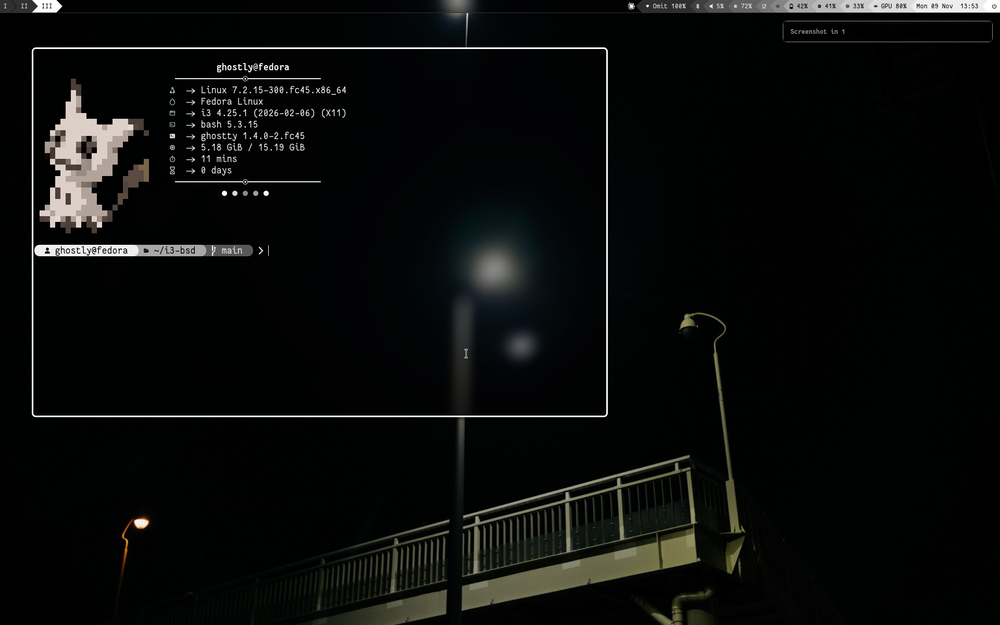

# i3

Monochrome i3 desktop, with a Settings window (`SUPER + ALT + M`) for network (Wi-Fi, Ethernet, IP and DNS, VPN, proxy), Bluetooth, sound, displays and brightness, the wallpaper (and a wallpaper slideshow), the look and the keys. The cursor is [Capitaine Cursors](assets/cursors).



## Install on Linux

Fedora (Workstation with GNOME, and KDE Plasma; up to Fedora 45), Arch, Debian/Ubuntu, Linux Mint.

Afterwards, log out and pick **i3** at the login screen. On GNOME: click your name, then the gear icon at the bottom right. On KDE: the "Desktop Session" menu under the password box. On Linux Mint: the small round icon next to your name. GNOME and KDE themselves run on Wayland only now, but their login screens still start X11 sessions like i3.

On Ubuntu 24.04 and Linux Mint 22, which don't package Ghostty or fastfetch, the installer gets them as `.deb` files: Ghostty 1.3.1 (the last version for Ubuntu 24.04) from [ghostty-ubuntu](https://github.com/mkasberg/ghostty-ubuntu), the community package listed on ghostty.org, and fastfetch from its own releases. Both are installed with apt, so the uninstaller removes them again.

```bash
git clone https://github.com/OmitGhostly/i3.git
cd i3
./install.sh
```

or in one line:

```bash
bash <(curl -fsSL https://raw.githubusercontent.com/OmitGhostly/i3/main/install.sh)
```

The file manager is [yazi](https://yazi-rs.github.io), opened in the terminal; folders opened from other programs go there too. On Fedora it comes from the [lihaohong/yazi](https://copr.fedorainfracloud.org/coprs/lihaohong/yazi/) COPR, on Debian/Ubuntu from the Snap Store (or yazi's own release build), elsewhere from your repos. Thunar stays installed, and Settings > Keybindings switches between them.

## FreeBSD, GhostBSD, OpenBSD, NetBSD

They have their own version of these dots: [OmitGhostly/i3-bsd](https://github.com/OmitGhostly/i3-bsd). A BSD desktop installed from here earlier moves there by itself at its next `i3dots-update`.

## Updates

After a system update (`pacman -Syu`, `dnf upgrade`, `apt upgrade`) you get a notification when a newer version of this config is on GitHub. Nothing changes until you install it:

```bash
i3dots-update
```

What you set in the Settings window is kept. Files you edited by hand in `~/.config` (the Ghostty config, the i3 config...) are replaced, and `i3dots-update --undo` puts back the version from before. Your own Ghostty settings belong in `~/.config/ghostty-local.conf`: Ghostty reads it last, and updates never touch it.

| Command | Does |
|---|---|
| `i3dots-update --check` | only say whether there is a newer version |
| `i3dots-update --status` | the installed version, and a newer one if there is |
| `i3dots-update --undo` | go back to the config from before the last update |
| `i3dots-update --off` / `--on` | no more checks after system updates / checks again |

## Uninstall

```bash
./uninstall.sh
```

| Option | Does |
|---|---|
| `--yes` | no questions: config, i3 and added programs |
| `--config-only` | config only, keep i3 and programs |
| `--all-programs` | also offer programs you already had |
| `--no-restore` | don't restore your old configs |
| `--force` | remove i3 even if it's your only desktop |
| `--dry-run` | show, change nothing |

## Keybinds

`SUPER` = Windows key. `SUPER + H` shows this list.

### Apps

| Key | Action |
|---|---|
| `SUPER + D` | App launcher (rofi) |
| `SUPER + Enter` | Open terminal |
| `SUPER + E` | File manager (yazi, in the terminal) |
| `SUPER + B` | Open default browser |
| `SUPER + C` | SSH session manager |
| `SUPER + H` | Help / cheat sheet |
| `SUPER + SHIFT + K` | Search keybinds |
| `SUPER + S` | Web search |
| `SUPER + A` | Window switcher (overview replacement) |
| `SUPER + CTRL + S` | Window switcher |
| `SUPER + ALT + E` | Emoji menu |
| `SUPER + ALT + C` | Calculator |
| `SUPER + ALT + V` | Clipboard manager |
| `SUPER + SHIFT + M` | Online music |
| `SUPER + SHIFT + E` | Quick settings menu |
| `SUPER + CTRL + R` | Rofi theme selector |
| `SUPER + CTRL + SHIFT + R` | Rofi theme selector (modified) |
| `SUPER + CTRL + K` | Kitty theme selector |
| `SUPER + SHIFT + O` | Change oh-my-zsh theme |
| `SUPER + ALT + R` | Refresh bar, colors, menus |
| `SUPER + SHIFT + Enter` | Drop-down terminal |
| `SUPER + ALT + D` | Display layout tool (arandr) |
| `SUPER + ALT + M` | Settings window (network: Wi-Fi, Ethernet, IP and DNS, VPN, proxy; Bluetooth, sound, displays and brightness, appearance, colors, themes, mouse and cursor, keybinds) |

### Look

| Key | Action |
|---|---|
| `SUPER + W` | Select wallpaper |
| `CTRL + ALT + W` | Random wallpaper |
| `SUPER + ALT + O` | Toggle compositor (blur/rounding/shadows) |
| `SUPER + CTRL + O` | Toggle active window opacity |
| `SUPER + SHIFT + G` | Toggle game mode |
| `SUPER + N` | Toggle night light |
| `SUPER + CTRL + ALT + B` | Toggle bar on/off |
| `SUPER + SHIFT + N` | Notification history |

### Session

| Key | Action |
|---|---|
| `SUPER + Q` | Close active window |
| `SUPER + SHIFT + Q` | Terminate active process |
| `CTRL + ALT + L` | Lock screen |
| `CTRL + ALT + P` | Power menu |
| `CTRL + ALT + Delete` | Exit / power menu |
| `SUPER + SHIFT + C` | Reload i3 config |
| `SUPER + SHIFT + R` | Restart i3 in place |

### Screenshots

| Key | Action |
|---|---|
| `SUPER + Print` | Screenshot now |
| `SUPER + SHIFT + Print` | Screenshot (area) |
| `SUPER + CTRL + Print` | Screenshot in 5s |
| `SUPER + CTRL + SHIFT + Print` | Screenshot in 10s |
| `ALT + Print` | Screenshot active window |
| `SUPER + SHIFT + S` | Screenshot + annotate |
| `SUPER + F6` | Screenshot now (F6) |
| `SUPER + SHIFT + F6` | Screenshot area (F6) |
| `SUPER + CTRL + F6` | Screenshot in 5s (F6) |
| `SUPER + ALT + F6` | Screenshot in 10s (F6) |
| `ALT + F6` | Screenshot active window (F6) |
| `ALT + SHIFT + S` | Region screenshot |

### Windows

| Key | Action |
|---|---|
| `SUPER + SHIFT + F` | Fullscreen |
| `SUPER + F` | Fullscreen (maximize) |
| `SUPER + Space` | Toggle floating |
| `SUPER + CTRL + Space` | Floating: standard size, centered |
| `SUPER + ALT + L` | Toggle layout (split/tabbed/stacking) |
| `SUPER + ALT + 1` | Layout: side by side (the normal split layout) |
| `SUPER + ALT + 2` | Layout: stacking |
| `SUPER + ALT + 3` | Layout: tabbed (monocle-like) |
| `SUPER + G` | Toggle group (tabbed/split) |
| `SUPER + SHIFT + I` | Toggle split direction |
| `SUPER + ALT + T` | Toggle spiral tiling like Hyprland (on) / classic side by side (off) |
| `SUPER + CTRL + H` | Focus parent container (group) |
| `SUPER + CTRL + J` | Focus child container |
| `SUPER + \` | Split next window horizontally |
| `SUPER + -` | Split next window vertically |
| `SUPER + SHIFT + T` | Toggle sticky |
| `SUPER + SHIFT + Space` | Focus: switch tiling/floating |
| `SUPER + J` | Focus next |
| `SUPER + K` | Focus previous |
| `ALT + Tab` | Focus next (alt-tab) |
| `ALT + SHIFT + Tab` | Focus previous (alt-shift-tab) |
| `SUPER + ←` | Focus left |
| `SUPER + ↓` | Focus down |
| `SUPER + ↑` | Focus up |
| `SUPER + →` | Focus right |
| `SUPER + CTRL + ←` | Move window left |
| `SUPER + CTRL + ↓` | Move window down |
| `SUPER + CTRL + ↑` | Move window up |
| `SUPER + CTRL + →` | Move window right |
| `SUPER + SHIFT + ←` | Resize: narrower |
| `SUPER + SHIFT + →` | Resize: wider |
| `SUPER + SHIFT + ↑` | Resize: shorter |
| `SUPER + SHIFT + ↓` | Resize: taller |
| `SUPER + SHIFT + U` | Move to scratchpad (special workspace) |
| `SUPER + U` | Toggle scratchpad (special workspace) |

### Workspaces

| Key | Action |
|---|---|
| `SUPER + 1 … 0` | Workspace 1 - 10 |
| `SUPER + SHIFT + 1 … 0` | Move to workspace 1 - 10 (follow) |
| `SUPER + CTRL + 1 … 0` | Move silently to workspace 1 - 10 |
| `SUPER + Tab` | Next workspace |
| `SUPER + SHIFT + Tab` | Previous workspace |
| `SUPER + .` | Next workspace (.) |
| `SUPER + ,` | Previous workspace (,) |
| `SUPER + scroll down` | Next workspace (scroll) |
| `SUPER + scroll up` | Previous workspace (scroll) |
| `SUPER + SHIFT + ]` | Move to next workspace (follow) |
| `SUPER + SHIFT + [` | Move to previous workspace (follow) |
| `SUPER + CTRL + ]` | Move silently to next workspace |
| `SUPER + CTRL + [` | Move silently to previous workspace |
| `SUPER + CTRL + F9` | Workspace to left monitor |
| `SUPER + CTRL + F10` | Workspace to right monitor |
| `SUPER + CTRL + F11` | Workspace to upper monitor |
| `SUPER + CTRL + F12` | Workspace to lower monitor |

### Media

| Key | Action |
|---|---|
| `Volume up key` | Volume up |
| `Volume down key` | Volume down |
| `ALT + Volume up key` | Volume up (precise) |
| `ALT + Volume down key` | Volume down (precise) |
| `Mute key` | Toggle mute |
| `Mic mute key` | Toggle mic mute |
| `Play key` | Play/pause |
| `Pause key` | Pause |
| `Next track key` | Next track |
| `Previous track key` | Previous track |
| `Stop key` | Stop |
| `Brightness up key` | Brightness up |
| `Brightness down key` | Brightness down |
| `CTRL + ALT + =` | Brightness up (kbd) |
| `CTRL + ALT + -` | Brightness down (kbd) |
| `CTRL + ALT + Numpad +` | Brightness up (numpad) |
| `CTRL + ALT + Numpad -` | Brightness down (numpad) |
| `Keyboard light up key` | Keyboard backlight up |
| `Keyboard light down key` | Keyboard backlight down |
| `Keyboard light key` | Keyboard backlight cycle |
| `Touchpad key` | Toggle touchpad |
| `Wi-Fi key` | Airplane mode |
| `Airplane key` | Airplane mode (rfkill key) |
| `Sleep key` | Sleep |

## Files

| Repo | Installed to | What |
|---|---|---|
| `config/i3/` | `~/.config/i3/` | i3, scripts, Settings |
| `config/polybar/` | `~/.config/polybar/` | bar |
| `config/picom/` | `~/.config/picom/` | compositor |
| `config/dunst/` | `~/.config/dunst/` | notifications |
| `config/ghostty/` | `~/.config/ghostty/` | terminal |
| `config/kitty/` | `~/.config/kitty/` | terminal |
| `config/yazi/` | `~/.config/yazi/` | file manager colours |
| `config/fastfetch/` | `~/.config/fastfetch/` | greeting |
| `config/cava/` | `~/.config/cava/` | visualiser |
| `config/touchegg/` | `~/.config/touchegg/` | gestures |
| `config/swappy/` | `~/.config/swappy/` | screenshot editor |
| `config/gtk-3.0/` | `~/.config/gtk-3.0/` | dark GTK |
| `wallpapers/` | `~/Pictures/wallpapers/` | wallpapers |
| `assets/cursors/` | `~/.local/share/icons/capitaine-cursors` | cursor (LGPL-3.0) |
| `uninstall.sh` | `~/.local/bin/i3dots-uninstall` | uninstaller |
| `tools/` | - | dev tools |

GPL-3.0 · based on [Hyprland-Dots](https://github.com/LinuxBeginnings/Hyprland-Dots)
